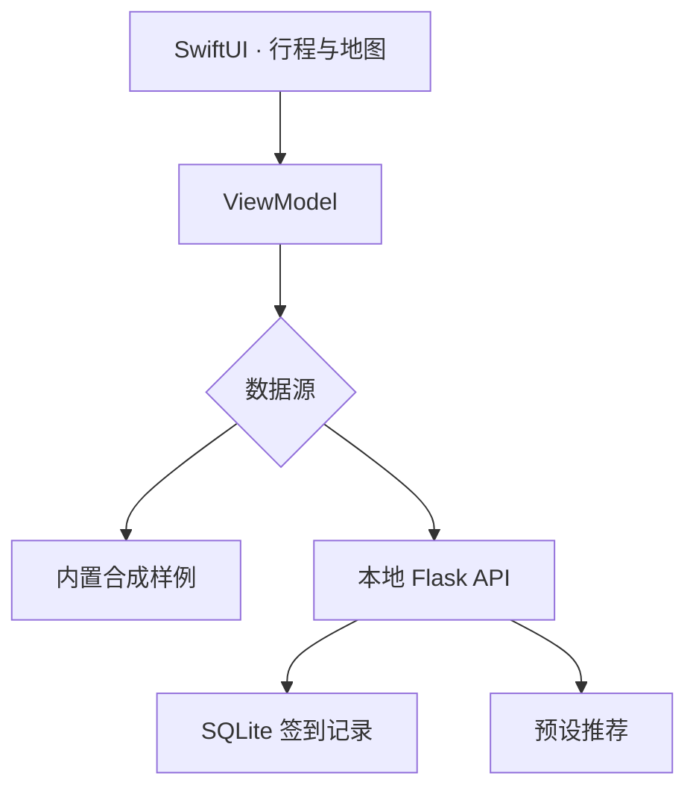

# 下一站 · 跨城市兴趣点推荐系统

我的本科毕业设计《基于时空和深度学习的兴趣点推荐系统的设计与实现》的展示版。系统根据用户在跨城市行程中的历史签到，推荐下一个可能到访的地点（Next POI），并用 iOS 地图展示签到轨迹和候选地点。

*An iOS and Flask portfolio demo for a bachelor's thesis on cross-city next point-of-interest recommendation.*

## 演示内容

- 切换上海 → 杭州、上海 → 苏州两条合成行程。地图默认聚焦目的地，也可缩放查看全程。
- 查看按时间排列的签到记录，在地图上显示下一站推荐。
- 从右上角切换到本地 Flask，查看请求如何经过 Swift 客户端、Flask API 和 SQLite。

演示用的地点、时间和用户编号均为合成样例。两种模式都返回预设推荐。训练代码、模型权重、原始签到数据和账号数据库未随展示版分发。

## 运行

**直接体验 iOS App。** 用 Xcode 16.2 或更新版本打开 [ios/NextPOI.xcodeproj](ios/NextPOI.xcodeproj)，选择 iOS 18.2 或更高版本的 iPhone 模拟器，运行 `NextPOI`。启动后默认使用内置演示数据，无需启动 Flask。MapKit 底图依赖网络。

**联调本地 Flask。** 使用 Python 3.9 或更高版本，在仓库根目录执行：

```bash
python3 -m venv .venv
source .venv/bin/activate
python -m pip install -r backend/requirements.txt
python backend/server.py
```

服务监听本机端口 5000，启动时用合成行程初始化 SQLite。在 iPhone 模拟器的 App 里点击右上角「数据源」，选「本地 Flask」。如果 Mac 上有其他进程占用端口 5000，先释放端口。

| 接口 | 示例请求体 | 返回内容 |
| --- | --- | --- |
| `GET /health` | 无 | 服务状态与演示模式 |
| `POST /get_records` | `{"user_id":1}` | 按行程分组的签到记录 |
| `POST /predict_poi` | `{"user_id":1,"sequence_num":2}` | 苏州行程的示例推荐 |

```bash
curl -sS http://localhost:5000/health
curl -sS http://localhost:5000/predict_poi \
  -H 'Content-Type: application/json' \
  -d '{"user_id":1,"sequence_num":2}'
```

## 系统设计

展示版保留了原毕设的「选择签到序列 → 请求推荐 → 地图呈现」流程和两个核心接口名。SwiftUI 负责界面与状态，MapKit 显示签到标记、轨迹和候选地点。iOS 和后端共用同一份 [合成样例](ios/NextPOI/Resources/DemoData.json)，Flask 将签到写入本地 SQLite，再按行程读取。



原毕设的研究模型基于 PyTorch。CSLS 用双路 LSTM 编码地点和类别序列，引入地理距离、访问频率与类别时间注意力，并融合用户的长短期偏好。完整的模型流程和论文中的离线实验结果见 [研究设计](docs/research.md)。
