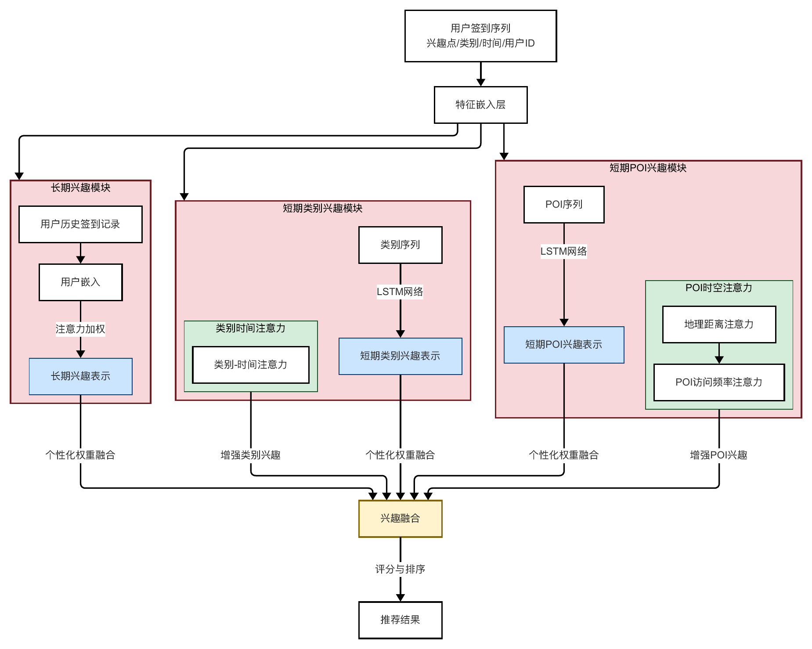

# 原毕设的推荐模型

研究任务是跨城市场景下的 Next POI 推荐。模型以用户按时间排序的历史签到为输入，输出候选地点排序。这一页记录论文中的模型设计和离线结果。仓库内演示使用合成签到与预设输出。

## CSLS

1. 用两路 LSTM 分别编码地点序列和地点类别序列。
2. 用三类注意力刻画地理距离、地点访问频率及类别在不同时间的访问偏好。
3. 融合用户长期与短期兴趣，为候选 POI 打分。
4. 通过 Flask 服务把预测地点及坐标返回给 iOS 客户端。

研究实现参考了 [PLSPL](https://github.com/YuxiaWu/PLSPL)。展示版中的 Flask 服务是独立的演示实现。

## 论文离线结果

以下数值摘录自本科论文表 4-2，是美国县域 Foursquare 子集和跨城市 Weeplaces 子集上的结果。表中展示 PLSPL 基线与论文的 CSLS 模型。

| 数据集 | 模型 | Recall@5 | Recall@10 | MAP@10 |
| --- | --- | ---: | ---: | ---: |
| Foursquare | PLSPL | 0.3268 | 0.4181 | 0.2281 |
| Foursquare | CSLS | 0.3958 | 0.4906 | 0.2610 |
| Weeplaces | PLSPL | 0.2488 | 0.3108 | 0.1768 |
| Weeplaces | CSLS | 0.2944 | 0.3610 | 0.2013 |
